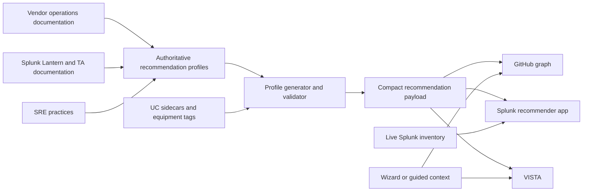

# Evidence-backed use-case recommendations — implementation and AI handoff guide

**Implemented:** 2026-09-19  
**Primary repository:** `splunk-monitoring-use-cases`  
**Consumer repository:** `Splunk-Vista`  
**Feature name:** recommendation profiles  
**Do not call this feature:** evidence packs

## 1. Purpose of this document

This document explains the complete implementation of evidence-backed use-case
recommendations: what problem it solves, why the architecture separates value
from readiness, which files are authoritative, how ranking works, how the
GitHub graph, Splunk recommender app, and VISTA consume the same contract, and
how another AI should safely extend or verify the implementation.

Read this document before changing any of the following:

- `data/recommendation-profiles/`
- `schemas/recommendation-profile.schema.json`
- `src/splunk_uc/generators/recommendation_profiles.py`
- `src/splunk_uc/generators/equipment_tags.py`
- `graph-recommend.js`
- `graph.html` or `graph-mvp.html`
- `src/splunk_uc/generators/recommender_app.py`
- the VISTA catalogue loader, use-case drawer, or recommendation skill

The shorter design contract remains in
[`docs/superpowers/specs/2026-09-19-evidence-backed-use-case-recommendations.md`](superpowers/specs/2026-09-19-evidence-backed-use-case-recommendations.md).
This guide is the implementation-level companion.

## 2. The original problem

The catalogue previously had two recommendation mechanisms, but neither
answered the customer question: **“Which use cases should I implement first
for this product?”**

### 2.1 Catalog metadata was being mistaken for customer value

The graph ranked use cases primarily from:

- quality tier;
- implementation wave;
- criticality;
- difficulty;
- aggregate quality score; and
- how closely an equipment tag matched the selected product.

Those fields are useful, but they describe documentation quality,
implementation effort, or generic operational impact. They do not establish
that a use case is a vendor-supported first monitoring control for a product.

For example, a thoroughly documented but peripheral Cisco ISE use case could
outrank authentication failure, replication health, or certificate expiry.
That is a quality ranking, not a product recommendation.

### 2.2 The Splunk app ranked inventory readiness, not value

The generated `splunk-uc-recommender` app used a match score resembling:

```text
exact sourcetype × high weight
+ CIM match × medium weight
+ installed-app/fuzzy match × lower weight
```

That score answers **“What could this Splunk deployment probably run now?”**
It does not answer **“What would be most valuable to implement?”**

Dropping a high-value use case because its data is absent is actively
unhelpful. Missing data is often the most important implementation finding.

### 2.3 Equipment matching was wrong before ranking began

Ranking cannot recover from an incomplete or noisy candidate set.

Observed examples included:

- dozens of Cisco ISE-titled use cases without `cisco_ise`;
- Palo Alto tags attached to VMware, Fortinet, and generic IPv6 use cases;
- Linux attached to any use case that mentioned Linux, including unrelated
  infrastructure products;
- VMware attached to neighbouring HCI technologies;
- AWS and Kubernetes<sup class="ref">[<a href="#ref-5">5</a>]</sup> attached because of incidental narrative references.

The former merge-only generator could add tags but could not reliably remove
false positives. A curated ranking profile would still fail if the product
could not be selected or if unrelated UCs flooded its fallback results.

### 2.4 Vendor-recommended controls had catalogue gaps

A cited core control must resolve to an actual catalogue identity. At the
start of the work:

- Kubernetes Node NotReady already existed as `UC-3.2.3`, but was not being
  reliably surfaced.
- Kubernetes OOMKilled/eviction did not have a precise catalogue UC.
- Palo Alto HA failover/HA1 health did not have a precise catalogue UC.

Silently omitting missing controls would make the profile look complete while
discarding vendor guidance. The chosen rule is: **author the missing UC first,
then reference it from the profile.**

## 3. Core architecture

The architecture separates three concerns that must not be collapsed:

1. **Value** — editorial, cited, product-specific priority.
2. **Readiness** — whether prerequisites, data, suites, maturity, or live
   inventory are present.
3. **Confidence** — how trustworthy and complete the catalogue documentation
   is.



The operational rule is:

```text
recommendation = profile value × contextual readiness
confidence = catalogue quality, shown separately
```

Quality tier is **not** allowed to become value again. Gold means the UC is
well documented and reviewed; it does not mean the UC is the first control a
customer needs.

## 4. Presentation classes

All consumers use four presentation classes:

| Internal value | UI label | Meaning |
|---|---|---|
| `start_now` | Start now | High-value and currently ready |
| `high_value_blocked` | High value, unblock first | High-value but missing readiness |
| `foundation` | Foundation | Enables or protects other controls |
| `later` | Later | Useful after the core pack |

The critical behavior is that a profile UC with no matching inventory is
reclassified as `high_value_blocked`; it is **not removed**.

This gives the user an implementation backlog:

- data already available → implement now;
- data missing → acquire or normalize it;
- dependency/foundation missing → build that first;
- lower-priority control → schedule later.

### 4.1 Current implementation boundary

The architecture deliberately carries roles, outcomes, suites, maturity,
dependencies, and required data, but the first implementation does **not**
pretend those fields are already a complete readiness rules engine.

What is dynamically enforced today:

- profile rank determines value;
- `classHint` establishes the editorial Start now/Foundation/Later intent;
- `inventoryReady[ucId]` can turn a high-value item into
  `high_value_blocked`;
- the Splunk app derives that readiness from whether inventory matching gave
  the UC a positive `_score`; and
- guided context changes the explanatory copy from a zero-context disclaimer
  to `why + whyNow`.

What is transported and normalized but not yet used to reorder results:

- roles;
- outcomes;
- suites;
- maturity;
- profile-level dependencies; and
- detailed required-data satisfaction.

VISTA currently uses profile core membership and `public_catalog_ids` for its
Recommended badge. Its context adapter prepares the shared context shape, but
the drawer does not yet run `rankForProduct()` or calculate per-UC readiness
from all wizard fields.

This distinction matters for future AI work: do not document contextual
reordering or prerequisite evaluation as present until executable rules and
tests are added. The fields are an additive contract and extension point.

## 5. Naming boundary: recommendation profiles versus evidence packs

This repository already uses `docs/evidence-packs/` for signed compliance
evidence. Reusing that name for product recommendations would conflate:

- compliance evidence and signatures;
- operational product guidance;
- recommendation rank; and
- audit assurance.

The implemented feature is therefore consistently named **recommendation
profiles**:

- source directory: `data/recommendation-profiles/`;
- schema: `recommendation-profile.schema.json`;
- generator: `generate-recommendation-profiles`;
- API: `api/v1/recommender/profiles.json`.

Do not introduce `evidenceProfile`, `evidencePack`, or similarly ambiguous
names into this feature.

## 6. Source hierarchy and evidence policy

Profiles are hand-authored because product priority is an editorial claim that
must be reviewable. The source hierarchy is:

1. vendor operations documentation;
2. Splunk Lantern<sup class="ref">[<a href="#ref-6">6</a>]</sup> and Splunk TA documentation;
3. established SRE practices;
4. existing catalogue UCs that implement those controls.

The implementation added or reused stable IDs in
`data/source-references.json`, including:

- `cisco-ise-admin`;
- `kubernetes-pod-lifecycle`; and
- `paloalto-ha`.

Profiles refer to source IDs, not free-form URLs. Stable IDs make validation,
reference maintenance, and future link-health audits possible.

### 6.1 No invented ROI

Profiles contain qualitative `valueHypothesis`, `why`, and `whyNow` text.
They do not contain fabricated percentages, cost savings, or incident
reduction claims.

Customer stories may be used as measurement patterns, but not as universal ROI
proof. If a quantified claim is ever proposed, it needs a real source and a
schema/design review rather than being inserted into rationale prose.

## 7. Recommendation-profile source contract

The authoritative source files are:

```text
data/recommendation-profiles/
├── aws.json
├── cisco_ise.json
├── kubernetes.json
├── linux.json
├── paloalto.json
└── vmware.json
```

Each file validates against
`schemas/recommendation-profile.schema.json`, a JSON Schema 2020-12 contract
with `additionalProperties: false`.

### 7.1 Profile-level fields

| Field | Purpose |
|---|---|
| `schemaVersion` | Pins the profile contract |
| `slug` | Equipment/product identity used by consumers |
| `label` | Human-readable product name |
| `variants` | Deployment/product variants covered |
| `corePack` | Ordered, cited list of 5–10 catalogue UCs |
| `role` | Primary operator personas |
| `outcomes` | Operational outcomes served |
| `valueHypothesis` | Qualitative explanation of why this pack matters |
| `requiredData` | Product-wide data requirements |
| `deps` | Prerequisite UC IDs or capability dependencies |
| `suites` | Splunk suites that affect readiness |
| `maturity` | Minimum crawl/walk/run stage |
| `sourceIds` | Profile-wide source references |
| `reviewDate` | Freshness checkpoint |
| `confidence` | Gold/silver/bronze editorial confidence |
| `rationale` | Reviewable explanation for the selection |

### 7.2 Core-pack item fields

Every core item contains:

- `ucId` — ID without the `UC-` display prefix;
- `rank` — explicit order from 1 through 10;
- `why` — why the control matters;
- `whyNow` — urgency or sequencing reason;
- `metric` — what the implementation should measure;
- `dataNeeded` — required data at this item’s level;
- `sourceIds` — evidence for the specific recommendation;
- optional `classHint`;
- optional `blocker`; and
- optional `role`.

The schema requires 5–10 core items. That range forces a real starting pack
without turning the profile into another unprioritized catalogue.

### 7.3 Why the profile stores IDs rather than embedded UCs

The profile references canonical catalogue IDs rather than duplicating titles,
SPL, implementation guidance, or criticality. This preserves:

- one identity for each use case;
- one source of truth for SPL;
- additive API compatibility;
- smaller public payloads; and
- independent maintenance of recommendation value and UC content.

## 8. The six pilot profiles

The work intentionally stops at six products until precision and ranking
benchmarks are trustworthy.

### 8.1 Cisco ISE (`cisco_ise`)

Core order:

1. `17.1.13` — 802.1X authentication failures;
2. `17.1.77` — PSN authentication-per-second capacity;
3. `17.1.28` — deployment replication and PSN sync;
4. `17.1.31` — certificate expiry and trust chain;
5. `17.1.29` — node CPU, memory, disk, and thread saturation;
6. `17.1.33` — pxGrid health;
7. `17.1.47` — backup success and age.

Why: ISE value begins with whether users can authenticate and whether the
distributed policy plane is healthy. Generic Cisco, IPv6, and unrelated
network UCs must not outrank those controls.

### 8.2 VMware vSphere (`vmware`)

Core order:

1. `2.1.3` — datastore capacity;
2. `2.1.42` — VM CPU ready;
3. `2.1.5` — snapshot sprawl;
4. `2.1.22` — vCenter health;
5. `2.1.7` — HA failover;
6. `2.1.4` — datastore latency;
7. `2.1.45` — snapshot age.

Why: these signals explain common guest availability and performance failures
at the virtualization layer. Neighbouring HCI products are not VMware merely
because they host VMs.

### 8.3 Palo Alto Networks PAN-OS (`paloalto`)

Core order:

1. `10.11.19` — threat-log severity;
2. `10.11.131` — HA failover and HA1 control-link health;
3. `10.11.94` — log forwarding and SIEM connectivity;
4. `10.11.93` — certificate inspection and trust;
5. `10.11.28` — Panorama commit/push failure;
6. `10.11.18` — GlobalProtect health;
7. `10.11.26` — User-ID mapping failure.

Why: the first controls keep the firewall effective, available, and visible.
VMware or Fortinet UCs that merely mention Palo Alto must not enter this pack.

### 8.4 Amazon Web Services (`aws`)

Core order:

1. `4.1.30` — CloudTrail delivery failure;
2. `10.7.104` — CloudTrail StopLogging/integrity;
3. `4.1.8` — GuardDuty ingestion;
4. `4.1.66` — AWS Config drift;
5. `4.1.2` — root account usage;
6. `4.1.4` — IAM policy changes;
7. `4.1.65` — GuardDuty severity.

Why: CloudTrail, GuardDuty, Config, IAM, and root are account-level security
and audit fundamentals. Incidental AWS references do not establish priority.

### 8.5 Kubernetes (`kubernetes`)

Core order:

1. `3.2.10` — CrashLoopBackOff;
2. `3.2.19` — API server latency;
3. `3.2.3` — Node NotReady;
4. `3.2.47` — OOMKilled and eviction;
5. `13.7.1` — log pipeline buffering/drops;
6. `3.2.13` — certificate expiry;
7. `3.2.7` — control-plane health.

Why: this follows workload, control-plane, node, memory, telemetry-pipeline,
and certificate failure modes. Docker-only OOM and incidental Kubernetes
mentions are not substitutes.

### 8.6 Linux OS telemetry (`linux`)

Core order:

1. `1.1.1` — CPU utilization;
2. `1.1.2` — memory pressure;
3. `1.1.3` — disk capacity;
4. `1.1.8` — SSH brute force/authentication failure;
5. `1.1.80` — systemd unit failures;
6. `1.1.7` — OOM killer events.

Why: Linux is treated as an operating-system telemetry product: CPU, memory,
disk, authentication, and service health. A UC is not a Linux core control
merely because Linux appears in a product’s implementation instructions.

## 9. Equipment-tag repair

Recommendation profiles override tag-derived ordering for the six products,
but equipment tags still matter for:

- product discovery and selection;
- the full Expert result set;
- fallback ranking;
- API consumers that do not load profiles; and
- coverage/recall reporting.

### 9.1 First-class Cisco ISE identity

`cisco_ise` was added to the curated equipment registry in
`tools/build/enrichment.py`, including its display metadata and matching
patterns. It is also used as a model compound where appropriate.

Without a first-class equipment slug, ISE could remain hidden behind broad
`cisco` tagging even when a profile existed.

### 9.2 Pilot tags are replace-not-merge

`src/splunk_uc/generators/equipment_tags.py` now treats these slugs as
generator-authoritative:

```text
cisco_ise
paloalto
linux
vmware
aws
kubernetes
```

For those six products, existing pilot tags and pilot model compounds are
removed and replaced with the freshly computed, refined result. Non-pilot tags
continue to merge so this work does not unexpectedly rewrite the whole
equipment taxonomy.

This asymmetry is deliberate. A merge-only algorithm can improve recall by
adding tags, but it cannot improve precision by deleting hitchhikers.

### 9.3 Product-specific refinement

After the generic equipment matcher runs, `_refine_pilot_tags()` applies
precision/recall rules:

- **ISE:** recognizes Cisco ISE, Identity Services Engine, `cisco:ise`,
  `Splunk_TA_cisco-ise`, pxGrid, PSN, RADIUS, and node wording; excludes
  generic IPv6 unless the title is genuinely ISE-related.
- **Palo Alto:** recognizes PAN-OS<sup class="ref">[<a href="#ref-3">3</a>]</sup>, GlobalProtect, Prisma Access,
  `Splunk_TA_paloalto`, and PAN sourcetypes; removes Palo Alto from VMware,
  Fortinet, Nutanix, or Citrix hitchhikers unless title/app evidence is direct.
- **Linux:** requires Linux/Unix/nix title or TA evidence plus an OS telemetry
  concept such as CPU, memory, disk, inode, auth, systemd, kernel, OOM, or
  service failure.
- **VMware:** recognizes VMware, vSphere<sup class="ref">[<a href="#ref-2">2</a>]</sup>, ESXi, vCenter, vSAN, and
  `Splunk_TA_vmware`; removes HCI/vendor hitchhikers without direct VMware
  evidence.
- **AWS:** recognizes AWS, CloudTrail, CloudWatch, GuardDuty, Config, IAM, and
  the AWS TA; removes incidental narrative-only matches.
- **Kubernetes:** recognizes Kubernetes, k8s, kubelet, kube-state,
  OpenShift, CrashLoop, and OOMKilled; requires title/app evidence before
  retaining the product tag.

### 9.4 Generator effects

Running the write-mode generator:

```bash
PYTHONPATH=src python3 -m splunk_uc generate-equipment-tags --report
```

processed 7,939 sidecars and changed 360 tag sets during this implementation.
The important pilot coverage after regeneration included:

- `cisco_ise`: 103 UCs;
- `paloalto`: 237 UCs;
- `linux`: 205 UCs;
- `vmware`: 202 UCs;
- `aws`: 496 UCs;
- `kubernetes`: 185 UCs.

These counts are not targets by themselves. Precision and anchor behavior are
more important than maximizing tag count.

Do not hand-edit generated equipment arrays. Fix the registry or refinement
rules, then regenerate.

## 10. Missing catalogue use cases

### 10.1 Kubernetes OOMKilled and eviction — `UC-3.2.47`

Added:

`content/cat-03-containers-orchestration/UC-3.2.47.json`

The UC distinguishes:

- container memory-limit violations (`OOMKilled`);
- kubelet/kernel OOM events;
- pod eviction under node memory pressure; and
- generic CrashLoopBackOff.

It includes:

- kube-state-metrics and Kubernetes event requirements;
- owner/namespace enrichment;
- severity logic;
- positive and negative control tests;
- CIM guidance;
- false-positive handling;
- detailed implementation steps; and
- prerequisite `3.2.10`.

Node NotReady was verified as already present in `UC-3.2.3`; it was referenced
rather than duplicated.

### 10.2 Palo Alto HA failover and HA1 health — `UC-10.11.131`

Added:

`content/cat-10-security-infrastructure/UC-10.11.131.json`

The UC detects:

- moved-to-active/failover events;
- HA1 heartbeat or peer-down events;
- path-monitor events;
- preemption; and
- related PAN-OS system-log signals.

It includes:

- `pan:system` data requirements;
- explicit exclusions from threat, forwarding, FortiGate<sup class="ref">[<a href="#ref-11">11</a>]</sup> HA, and Prisma UCs;
- positive and negative control tests;
- operational severity;
- detailed troubleshooting;
- Palo Alto references; and
- prerequisite `10.11.94`.

## 11. Generator and compact public artifact

The new CLI verb is registered in `src/splunk_uc/_registry.py`:

```bash
PYTHONPATH=src python3 -m splunk_uc generate-recommendation-profiles
PYTHONPATH=src python3 -m splunk_uc generate-recommendation-profiles --check
```

Implementation:

`src/splunk_uc/generators/recommendation_profiles.py`

### 11.1 Validation performed

The generator validates:

- every profile against JSON Schema Draft 2020-12;
- profile filename equals `slug`;
- core ranks are sorted and unique;
- every `ucId` exists in `content/`;
- every item-level `sourceId` exists;
- every profile-level `sourceId` exists.

It accumulates validation errors and reports them together so authors can fix
the full profile in one pass.

### 11.2 Determinism

The output uses:

- sorted profile filenames;
- sorted core items by rank;
- `sort_keys=True`;
- stable indentation and trailing newline; and
- a deterministic timestamp.

Timestamp resolution order:

1. `SOURCE_DATE_EPOCH`;
2. latest Git commit timestamp;
3. current UTC only as a final fallback.

This is necessary because the generated artifact is committed and checked for
drift. A wall-clock timestamp would make every regeneration differ.

### 11.3 Outputs

The same compact payload is written to:

- `graph-recommend.json`; and
- `api/v1/recommender/profiles.json`.

The root artifact supports the static graph. The additive API path supports
VISTA, the Splunk app, and other consumers without changing the existing
catalogue contract.

### 11.4 Compact key mapping

Core entries use short keys:

| Compact key | Source field |
|---|---|
| `i` | `ucId` |
| `r` | `rank` |
| `why` | `why` |
| `now` | `whyNow` |
| `m` | `metric` |
| `d` | `dataNeeded` |
| `src` | `sourceIds` |
| `c` | `classHint` |
| `blk` | `blocker` |

The compact artifact intentionally omits full UC content. Consumers resolve
`i` against the catalogue or thin API.

### 11.5 Build integration

The feature was wired into:

- `Makefile` generation and drift-check cascades;
- `tools/build/build.py` static project assets;
- `src/splunk_uc/generators/api_surface.py`;
- the `splunk_uc` verb registry; and
- the additive `/api/v1/recommender/profiles.json` manifest link.

`graph-mvp.html`, `graph-recommend.js`, and `graph-recommend.json` are copied
into the built site.

## 12. Shared ranking engine

`graph-recommend.js` is deliberately DOM-free and network-free. It can run:

- as a browser global (`window.UCRecommend`);
- as a Node import in tests; and
- as a logic contract for VISTA.

### 12.1 Index construction

`buildIndex(catalog)`:

1. flattens categories/subcategories into UC entries;
2. builds `bySlug` from actual UC equipment tags;
3. builds `byId`;
4. adds curated EQUIPMENT metadata when available; and
5. keeps products referenced by UCs even if absent from the registry.

That last behavior preserves reachability for unregistered slugs such as
Juniper, Arista, or Splunk ES.

### 12.2 Profile attachment

Consumers call:

```javascript
const index = UCRecommend.buildIndex(catalog);
UCRecommend.attachProfiles(profilePayload);
UCRecommend.bindProfiles(index);
```

`bindProfiles()` ensures a profile-backed slug is selectable even if its
equipment tag coverage is temporarily empty. This is another safeguard against
tagging defects hiding the authoritative profile.

### 12.3 Profile-backed ranking

For a profiled product:

1. core-pack UCs are resolved by ID;
2. profile rank receives dominant ordering weight;
3. evidence text and data requirements decorate each result;
4. readiness produces the presentation class;
5. non-core tagged UCs are appended as `later`; and
6. deterministic ID comparison breaks ties.

The dominant profile score is intentional:

```javascript
(11 - rank) * 1000
```

Catalog metadata must not silently override the hand-reviewed profile order.

### 12.4 Catalog-only fallback

If no profile exists for a slug, the engine retains the previous metadata and
specificity ranker. This makes the feature additive and avoids blocking the
remaining equipment catalogue while profiles are authored gradually.

The fallback combines:

- documentation quality;
- wave;
- criticality;
- difficulty;
- status;
- quality score;
- product specificity; and
- UC equipment focus.

This score is a fallback relevance heuristic, not evidence-backed value.

### 12.5 Zero-context versus guided explanation

Without questionnaire context, the reason begins:

> Best-practice starting point.

With role/outcome/suite/maturity context, the engine combines `why` and
`whyNow`. It must not claim “most valuable for you” without customer context.

### 12.6 Context mapping

`contextFromWizard()` normalizes:

- `roles` or `audience`;
- `desiredOutcomes` or `outcomes`;
- `premiumSuites` or `suites`;
- implementation wave/maturity;
- vertical; and
- optional `inventoryReady`.

Suite aliases normalize to:

- `itsi`;
- `es`;
- `o11y`; or
- lower-cased passthrough.

In the current ranker, the normalized fields establish a shared contract and
switch the explanation into guided mode. Only `inventoryReady` dynamically
changes a presentation class. Any future weighting by role, outcome, suite,
vertical, or maturity must be specified and benchmarked rather than inferred
from the mere presence of those fields.

### 12.7 Merged-stack diversification

`startHere()` round-robins across selected products so one product cannot
consume the whole page. It also applies a category share cap for mixed stacks
and de-duplicates UCs that match several products.

An important correction was made during verification: the category cap is
disabled for a single selected product. Otherwise, ISE’s category-17 core pack
was incorrectly displaced by lower-priority cross-category UCs.

For one product:

```text
categoryCap = requested result count
```

For multiple products:

```text
categoryCap = ceil(requested result count × 0.34)
```

Deferred entries top up sparse pages after the fair first pass.

## 13. GitHub graph implementation

The existing two-lens UX was preserved:

- **Guided:** short, evidence-backed starting set in plain language.
- **Expert:** full equipment matches, quality, CIM, wave, and coverage detail.

`graph-mvp.html` was updated first and then promoted into `graph.html`.

The page loads:

1. `graph-data.json`;
2. `catalog.json` (with `dist/catalog.json` fallback); and
3. `graph-recommend.json`.

Cards now display:

- presentation class;
- confidence separately from value;
- why;
- why now;
- metric to watch;
- data needed;
- source IDs; and
- the canonical UC link.

The zero-context page explicitly says it is a best-practice starting point,
not a personalized value claim.

### 13.1 Expected pilot behavior

Verified single-product Guided order includes:

```text
ISE:
17.1.13, 17.1.77, 17.1.28, 17.1.31, 17.1.29, 17.1.33, 17.1.47

Palo Alto:
10.11.19, 10.11.131, 10.11.94, 10.11.93, 10.11.28,
10.11.18, 10.11.26
```

A mixed `cisco_ise,paloalto,linux` stack begins by round-robinning:

```text
cisco_ise:17.1.13
paloalto:10.11.19
linux:1.1.1
cisco_ise:17.1.77
paloalto:10.11.131
linux:1.1.2
```

## 14. Splunk recommender app

Generated files under `splunk-apps/splunk-uc-recommender/` were not edited by
hand. The source of truth is:

`src/splunk_uc/generators/recommender_app.py`

Then the app was regenerated:

```bash
PYTHONPATH=src python3 -m splunk_uc generate-recommender-app
```

### 14.1 Remote data

The browser-side app now fetches:

- sourcetype index;
- CIM index;
- app index;
- thin UC index;
- Splunkbase<sup class="ref">[<a href="#ref-19">19</a>]</sup> index; and
- recommendation profiles.

The profile endpoint is:

```text
/api/v1/recommender/profiles.json
```

Fetches retain:

- the origin allow-list;
- `credentials: 'omit'`;
- graceful per-endpoint failure via `Promise.allSettled`; and
- browser-side execution only.

No credentials, tokens, or server-side outbound fetches were introduced.

### 14.2 Value and readiness in the app

The existing inventory match `_score` remains useful, but its meaning is now
readiness.

`applyRecommendationProfiles()`:

1. indexes already matched rows by UC ID;
2. walks all profile core items;
3. treats `_score > 0` as inventory-ready;
4. marks unready high-value items `high_value_blocked`;
5. creates a thin row when a core UC was absent from inventory matches;
6. attaches profile rank, why, why-now, metric, sources, and product slug; and
7. sorts by presentation class, then profile rank, then inventory score.

This ensures the app shows both:

- what can be enabled now; and
- what high-value capability needs data first.

### 14.3 Test export

`matchUseCases` and `applyRecommendationProfiles` are exposed through the
generated test helper. This is required because Node tests evaluate the
generated AMD module in a sandbox.

Always regenerate after editing the Python generator before running Node
tests; otherwise tests exercise stale generated JavaScript.

## 15. VISTA integration

VISTA is a separate repository and should be delivered as a separate PR.
The catalogue publishes the profile contract; VISTA consumes it.

### 15.1 Opt-in and air-gapped behavior

`methodology/js/data/uc-catalog-loader.js` derives the profile URL from the
configured catalogue URL:

```text
.../catalog.json
→ .../api/v1/recommender/profiles.json
```

Profiles are fetched only as part of the opt-in catalogue load. The default
air-gapped behavior remains unchanged.

The fetch uses:

- `credentials: 'omit'`;
- JSON-only acceptance;
- graceful `null` fallback; and
- an in-memory `coreIdSet`.

The loader publishes:

```javascript
window.UCRecommendProfiles = {
  payload,
  coreIdSet
};
```

### 15.2 Wizard context mapping

Added:

`methodology/js/utils/recommendation-context.js`

It maps VISTA form data into the same conceptual context as the graph:

- roles/audience;
- desired outcomes;
- premium suites;
- crawl/walk/run maturity;
- vertical; and
- optional inventory readiness.

`Vista.html` loads this utility after the UC library adapter.

This utility is preparatory infrastructure. The use-case drawer exposes a
`recommendationContext()` method, but the current VISTA change does not yet
execute the catalogue’s shared ranker or use the mapped values to reorder the
drawer. Current VISTA recommendation behavior is profile-membership badging,
plus offline fallback.

### 15.3 Recommended badge behavior

`methodology/js/components/use-cases-drawer.js` now:

- preserves curated UC `public_catalog_ids`;
- checks loaded profile core IDs;
- checks mapped `public_catalog_ids`; and
- avoids falling back to broad vertical-only recommendation when profile data
  is available.

If profiles are unavailable, the previous offline/vertical behavior remains a
fallback.

### 15.4 Public catalogue mappings

Two existing curated VISTA use cases were mapped:

- campus ISE authentication correlation → `17.1.13`;
- Kubernetes namespace utilization → `3.2.19`, `3.2.3`.

After editing module YAML, `methodology/js/data/modules-data.js` was
regenerated.

Future mappings must be semantically reviewed. Do not map IDs merely because
titles share a product name.

### 15.5 Prioritization skill

Added in VISTA:

`methodology/skills/splunk-use-case-prioritization/SKILL.md`

Registered in:

`methodology/skill-manifest/MANIFEST.yaml`

Then regenerated:

- `methodology/skill-manifest/schema.json`;
- `methodology/js/data/skill-catalog.js`.

A copy for catalogue authors who do not have the VISTA checkout lives at:

`docs/skills/splunk-use-case-prioritization/SKILL.md`

The skill records:

- source hierarchy;
- profile authoring rules;
- no-ROI policy;
- value/readiness separation;
- VISTA mapping behavior;
- freshness expectations; and
- verification anchors.

## 16. Tests and benchmarks

### 16.1 Profile generator tests

`tests/splunk_uc/generators/test_recommendation_profiles.py` verifies:

- every core UC exists;
- compact output is deterministic;
- profile slugs are sorted; and
- schema/profile files exist.

### 16.2 Equipment precision/recall tests

`tests/splunk_uc/generators/test_pilot_equipment_recall.py` verifies:

- every Cisco ISE/Identity Services Engine-titled UC is recognized as
  `cisco_ise`; and
- VMware/vSphere/vCenter titles do not retain Palo Alto unless they are
  genuinely Palo Alto-related.

Additional unit coverage in
`tests/splunk_uc/generators/test_equipment_tags.py` pins pilot replacement and
refinement behavior.

### 16.3 Ranking tests

`tests/recommender/profile_rank.test.mjs` verifies:

- every compact profile ID resolves in the built catalogue;
- each pilot’s top five contains its expected anchors;
- guided top ten retains the anchor set;
- blocked inventory produces `high_value_blocked`;
- zero-context copy says “Best-practice starting point”;
- ranking is deterministic; and
- VISTA-style context maps suites/outcomes/maturity.

`tests/recommender/graph_mvp_rank.test.mjs` verifies:

- non-registry products remain reachable;
- each selected product appears;
- no product monopolizes a mixed shortlist;
- categories are diversified;
- scores do not collapse into ties;
- single-product Guided retains its profile core;
- results contain reasons; and
- per-product sections are populated.

### 16.4 Splunk app tests

`tests/recommender/match.test.mjs` retains all inventory-matching tests and adds
a contract that a profile UC with no inventory remains visible as
`high_value_blocked` with `_score = 0`.

### 16.5 Contract tests

`tests/build/test_graph_mvp_contract.py` verifies that the page:

- contains Guided and Expert lenses;
- starts from inventory/product selection;
- loads the shared ranker and profile artifact;
- renders per-product sections;
- keeps recommendations visible on mobile; and
- does not reimplement the ranker inline.

## 17. Verification performed

The following checks passed during implementation:

```bash
PYTHONPATH=src python3 -m splunk_uc generate-recommendation-profiles --check
PYTHONPATH=src python3 -m splunk_uc generate-recommender-app --check
PYTHONPATH=src python3 -m splunk_uc generate-equipment-tags --check
```

Targeted Python tests passed:

```text
14 passed
```

Profile and graph Node tests passed:

```text
34 passed
```

Generated recommender match tests passed:

```text
26 passed
```

The engine was also exercised for:

- ISE Guided;
- ISE per-product/Expert behavior;
- Palo Alto Guided; and
- a mixed ISE + Palo Alto + Linux stack.

### 17.1 Verification limitation

There was no browser-automation tool available in the implementation session.
The graph behavior was verified through the same pure ranking engine used by
the browser and through HTML contract tests, but a real viewport was not
clicked automatically.

For a manual smoke test, serve the repository or build output and open:

```text
graph.html?eq=cisco_ise&view=guided
graph.html?eq=paloalto&view=expert
graph.html?eq=cisco_ise,paloalto,linux&view=guided
```

Check list behavior, classes, profile explanations, per-product sections,
Expert coverage, and persistence. A screenshot alone is insufficient; the
interaction and ordering must be inspected.

## 18. How another AI should extend the feature

Use this sequence. Do not start by changing the ranker.

### Step 1 — Define the product boundary

Write down what the slug means.

Examples:

- Linux means OS telemetry, not products implemented on Linux.
- Kubernetes means cluster/workload control-plane telemetry, not every
  container mention.
- VMware means vSphere/vCenter/vSAN, not every HCI platform.

If the boundary is ambiguous, equipment tags and profiles will both be wrong.

### Step 2 — Research the operational core

Use the source order:

1. vendor operations docs;
2. Splunk TA/Lantern docs;
3. SRE practice;
4. catalogue mappings.

Build a provisional list of 5–10 controls. Record source IDs. Do not invent
metrics or ROI.

### Step 3 — Audit equipment precision and recall

Search titles, app fields, data sources, and SPL. Establish:

- obvious true positives;
- obvious false positives;
- expected model compounds; and
- ambiguous terms.

Add tests before broad regeneration. Prefer semantic title/app evidence over
long narrative matches.

### Step 4 — Add or refine equipment rules

Update the curated EQUIPMENT registry when the slug is missing. Add narrowly
scoped product refinement only when generic matching cannot express the
boundary.

Decide whether the product must become generator-authoritative
replace-not-merge. This is appropriate when false-positive removal is a
feature requirement.

### Step 5 — Resolve every proposed anchor

For each core control:

- find the exact catalogue UC;
- verify title, SPL, data, and implementation are semantically correct;
- retag if it exists but is invisible;
- author a new UC if it genuinely does not exist.

Never reference a near match to avoid authoring the correct UC.

### Step 6 — Register sources

Add stable source IDs to `data/source-references.json`. Reuse existing IDs
when the source already exists. Avoid profile-local URLs.

### Step 7 — Author the profile

Create `data/recommendation-profiles/<slug>.json`.

Ensure:

- 5–10 ordered items;
- every rank is unique;
- each item has evidence;
- `why` and `whyNow` are distinct;
- metrics are operational and observable;
- data requirements are concrete;
- confidence is evidence-based; and
- review date is current.

### Step 8 — Generate and inspect

```bash
PYTHONPATH=src python3 -m splunk_uc generate-equipment-tags --report
PYTHONPATH=src python3 -m splunk_uc generate-recommendation-profiles
PYTHONPATH=src python3 -m splunk_uc generate-recommender-app
```

Review the diff. Large equipment changes require sampling false positives, not
just accepting generator output.

### Step 9 — Add anchor benchmarks

Extend `ANCHORS` in `tests/recommender/profile_rank.test.mjs`. Add precision
and recall assertions relevant to the new product.

Test:

- zero-context top five;
- guided top ten;
- blocked inventory;
- mixed stack fairness;
- deterministic output; and
- missing UC/source failures.

### Step 10 — Update VISTA separately

If a VISTA curated UC has a true catalogue equivalent, add
`public_catalog_ids`, regenerate `modules-data.js`, and verify the drawer.

Do not make the catalogue implementation depend on a VISTA checkout. VISTA is
a consumer and should be a separate PR.

### Step 11 — Run the full checks

At minimum:

```bash
PYTHONPATH=src python3 -m splunk_uc generate-equipment-tags --check
PYTHONPATH=src python3 -m splunk_uc generate-recommendation-profiles --check
PYTHONPATH=src python3 -m splunk_uc generate-recommender-app --check
node --test tests/recommender/*.test.mjs
make build
make audit
```

Run targeted schema/UC tests for any newly authored sidecar. Use the
repository’s supported Python 3.11+ environment.

## 19. Common failure modes

### 19.1 Ranking quality as value

**Symptom:** Gold UCs automatically outrank profile cores.

**Cause:** Profile order was blended with or subordinated to metadata score.

**Fix:** Keep profile rank dominant. Show quality as confidence.

### 19.2 Dropping blocked high-value UCs

**Symptom:** Recommendations disappear when sourcetypes are absent.

**Cause:** Inventory match is being used as an inclusion filter.

**Fix:** Synthesize the thin profile row and classify it
`high_value_blocked`.

### 19.3 Merge-only tagging

**Symptom:** False-positive Palo Alto/Linux/VMware tags persist forever.

**Cause:** New computed tags were unioned with stale pilot tags.

**Fix:** Replace generator-authoritative pilot tags while preserving unrelated
tags.

### 19.4 Substring-greedy Linux matching

**Symptom:** Linux appears on product UCs that merely mention an installation
host.

**Fix:** Require OS identity plus an OS telemetry concept.

### 19.5 Category cap displacing a single product’s core

**Symptom:** ISE Guided shows three profile UCs followed by unrelated
cross-category items.

**Cause:** Mixed-stack diversification was applied to one product.

**Fix:** Disable the category cap when `active.length === 1`.

### 19.6 Editing generated Splunk app files

**Symptom:** Generator `--check` overwrites or rejects a UI fix.

**Fix:** Edit `src/splunk_uc/generators/recommender_app.py`, regenerate, then
test the generated AMD module.

### 19.7 Stale generated JavaScript during testing

**Symptom:** Node reports a missing exported helper after Python was updated.

**Fix:** Run `generate-recommender-app` before Node tests.

### 19.8 Non-deterministic timestamps

**Symptom:** `profiles.json` changes on every run.

**Fix:** Use `SOURCE_DATE_EPOCH` or Git commit time; retain sorted serialization.

### 19.9 Calling profiles “evidence packs”

**Symptom:** Product recommendation artifacts are confused with compliance
evidence/signatures.

**Fix:** Use recommendation-profile terminology everywhere.

### 19.10 Overstating personalization

**Symptom:** Zero-context UI says “most valuable for you.”

**Fix:** Use “Best-practice starting point” until customer context is present.

## 20. Security and trust boundaries

This feature does not require or store credentials.

Security-preserving choices include:

- public, non-secret profile payloads;
- browser-side remote fetches only;
- `credentials: 'omit'`;
- origin allow-list enforcement in the Splunk app;
- safe text rendering rather than remote `innerHTML`;
- additive APIs;
- schema validation;
- source-ID validation;
- deterministic generated files; and
- opt-in VISTA network access.

No certificates were embedded or loaded as part of this feature. If future
work adds certificate material, it must be externally managed and verified for
validity, key strength, signature algorithm, and issuer trust rather than
hardcoded.

## 21. Ownership and maintenance

Treat these layers independently:

| Layer | Source of truth | Typical owner action |
|---|---|---|
| Product value | Recommendation profile | Review sources and rank |
| UC implementation | `content/**/*.json` | Maintain SPL and guidance |
| Equipment reachability | Equipment registry/tag generator | Fix precision/recall |
| Public transport | Profile generator/API | Preserve deterministic contract |
| Graph presentation | Shared ranker + HTML | Preserve value/readiness semantics |
| Splunk readiness | Recommender generator | Match live inventory |
| VISTA context | VISTA loader/drawer/context adapter | Map wizard fields |
| Confidence | UC quality tier/profile confidence | Review separately from value |

Re-review a profile when:

- vendor guidance changes;
- the TA changes sourcetypes or supported data;
- a core UC is renamed, replaced, or deprecated;
- a better catalogue UC is authored;
- false-positive tag tests expose a boundary problem; or
- operator feedback shows the core sequence is wrong.

## 22. Deliberately deferred scope

The implementation does not include:

- recommendation-aware MCP `search_use_cases`;
- profiles for all 331+ equipment slugs;
- a Splunk Lantern-style Use Case Registry export;
- live CISA KEV lookups;
- invented customer ROI;
- automatic profile authoring from metadata; or
- default-on VISTA network access.

These exclusions preserve reviewability and keep the initial six-product
benchmark meaningful.

## 23. Final implementation invariants

Before accepting any future change, verify all of the following:

1. Product value comes from a cited profile when one exists.
2. Readiness never silently becomes value.
3. Missing data blocks a recommendation; it does not erase it.
4. Quality tier remains confidence.
5. Every core ID resolves to a real UC.
6. Every source ID resolves to the source registry.
7. Profiles remain deterministic and schema-valid.
8. Pilot equipment tags remain precise enough to support discovery.
9. Single-product Guided preserves the full core order.
10. Mixed stacks remain fair through round-robin and de-duplication.
11. Unprofiled products retain a catalog-only fallback.
12. Generated Splunk files are changed only through their generator.
13. VISTA remains opt-in and air-gap safe.
14. Recommendation profiles are never confused with compliance evidence packs.
15. No secrets, credentials, or certificate material are committed.

Those invariants are the reason the feature is structured as several small,
testable contracts rather than one opaque recommendation score.

---

<!-- BEGIN-AUTOGENERATED-SOURCES -->

## References

*Auto-generated by `scripts/generate_doc_references.py` from `data/source-references.json` and `data/source-mappings.json`. Edit those files (or the document body) to change citations; this footer is rewritten on every run.*

### Primary sources

<a id="ref-1"></a>**[1]** Cisco Systems, Inc. (2026). *Cisco ISE Administrator Guide — Distributed Deployment, Certificates, pxGrid, and Backup*. Retrieved May 11, 2026, from https://www.cisco.com/c/en/us/support/security/identity-services-engine/products-installation-and-configuration-guides-list.html

<a id="ref-2"></a>**[2]** Broadcom Inc. / VMware. (2026). *VMware vSphere Documentation*. Broadcom Inc. Retrieved May 11, 2026, from https://docs.vmware.com/en/VMware-vSphere/

<a id="ref-3"></a>**[3]** Palo Alto Networks, Inc. (2026). *Palo Alto Networks PAN-OS Documentation*. Retrieved May 11, 2026, from https://docs.paloaltonetworks.com/pan-os

<a id="ref-4"></a>**[4]** Amazon Web Services, Inc. (2026). *AWS CloudTrail User Guide*. Retrieved May 11, 2026, from https://docs.aws.amazon.com/awscloudtrail/latest/userguide/cloudtrail-user-guide.html

<a id="ref-5"></a>**[5]** The Kubernetes Authors. (2026). *Kubernetes Documentation*. Cloud Native Computing Foundation. Retrieved May 11, 2026, from https://kubernetes.io/docs/

<a id="ref-6"></a>**[6]** Splunk Inc. (2026). *Splunk Lantern — customer success knowledge base*. Splunk LLC, a Cisco company. Retrieved May 11, 2026, from https://lantern.splunk.com/

### Supporting sources

<a id="ref-7"></a>**[7]** Amazon Web Services, Inc. (2026). *Amazon GuardDuty User Guide*. Retrieved May 11, 2026, from https://docs.aws.amazon.com/guardduty/latest/ug/what-is-guardduty.html

<a id="ref-8"></a>**[8]** Beyer, B., Jones, C., Petoff, J., & Murphy, N. R. (2016). *Monitoring Distributed Systems (Chapter 6 of Site Reliability Engineering)*. O'Reilly Media / Google. https://sre.google/sre-book/monitoring-distributed-systems/

<a id="ref-9"></a>**[9]** Beyer, B., Jones, C., Petoff, J., & Murphy, N. R. (Eds.). (2016). *Site Reliability Engineering: How Google Runs Production Systems*. O'Reilly Media. ISBN 978-1491929124. https://sre.google/sre-book/table-of-contents/

<a id="ref-10"></a>**[10]** Cloud Software Group. (2026). *Citrix Virtual Apps and Desktops Documentation*. Cloud Software Group, Inc. Retrieved May 11, 2026, from https://docs.citrix.com/en-us/citrix-virtual-apps-desktops

<a id="ref-11"></a>**[11]** Fortinet, Inc. (2026). *Fortinet FortiOS Documentation*. Retrieved May 11, 2026, from https://docs.fortinet.com/product/fortigate

<a id="ref-12"></a>**[12]** The Kubernetes Authors. (2026). *Kubernetes Documentation — Pod lifecycle, OOMKilled, and node conditions*. Cloud Native Computing Foundation. Retrieved May 11, 2026, from https://kubernetes.io/docs/concepts/workloads/pods/pod-lifecycle/

<a id="ref-13"></a>**[13]** Murphy, N., et al. (2018). *Alerting on SLOs (Chapter 5 of The Site Reliability Workbook)*. O'Reilly Media / Google. https://sre.google/workbook/alerting-on-slos/

<a id="ref-14"></a>**[14]** National Institute of Standards and Technology. (2024). *Cybersecurity Framework (CSF) 2.0* (2.0). U.S. Department of Commerce. NIST CSWP 29. https://www.nist.gov/cyberframework

<a id="ref-15"></a>**[15]** Palo Alto Networks. (2026). *PAN-OS Administrator's Guide — High Availability*. Palo Alto Networks, Inc. Retrieved May 11, 2026, from https://docs.paloaltonetworks.com/pan-os/11-1/pan-os-admin/high-availability

<a id="ref-16"></a>**[16]** Red Hat, Inc. (2026). *Red Hat OpenShift Container Platform Documentation*. Retrieved May 11, 2026, from https://docs.openshift.com/container-platform/latest/welcome/index.html

<a id="ref-17"></a>**[17]** Splunk Inc. (2026). *Search Reference: SPL Commands and Functions*. Splunk LLC, a Cisco company. Retrieved May 11, 2026, from https://docs.splunk.com/Documentation/Splunk/latest/SearchReference/WhatsInThisManual

<a id="ref-18"></a>**[18]** Splunk Inc. (2026). *Splunk Enterprise Security Administration Manual*. Splunk LLC, a Cisco company. Retrieved May 11, 2026, from https://docs.splunk.com/Documentation/ES

<a id="ref-19"></a>**[19]** Splunk Inc. (2026). *Splunkbase — the Splunk app marketplace*. Splunk LLC, a Cisco company. Retrieved May 11, 2026, from https://splunkbase.splunk.com/

<!-- END-AUTOGENERATED-SOURCES -->
