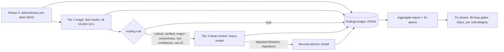

# UC Text-Quality and Correctness Review

Plan authored with Claude Opus 5.5 (high). Evaluation model recommendations are at the end.

## What the research showed (why the plan looks like this)

- 16,654 UCs, about 118M characters of prose (median `detailedImplementation` is 4,959 chars). Critical: 1,583, high: 6,869. 1,672 UCs claim `status: verified`, and only 3,605 have `lastReviewed`.
- The existing template detector ([`src/splunk_uc/audits/_template_fingerprints.py`](src/splunk_uc/audits/_template_fingerprints.py)) now reports **0** hits. A newer generation of templated text is everywhere and is not detected:
  - "Variant N confirms": 14,301 UCs
  - "Purpose-built for": 8,033
  - "\*\*Maintenance window on `": 4,011
  - `ops_exception_register.csv`: 3,305
  - bare `https://lantern.splunk.com/` reference: 1,975
  - "Detects UC-X.Y.Z —" description opener: 1,831
  - About 5,000 `value` fields share four sentence skeletons (for example "Operators running UC on X feeds shorten triage").
- Correctness problems sit next to the templates. Example from [`content/cat-05-network-infrastructure/UC-5.1.1.json`](content/cat-05-network-infrastructure/UC-5.1.1.json): a UBA premium app on an interface up/down UC, `Network_Traffic` used as the CIM model for link-state events while `cimModels` is `[]`, and title tokens rendered as "Interface, Down, Events".
- Existing standards to grade against: [`docs/content-editorial-review-standard.md`](docs/content-editorial-review-standard.md), [`docs/uc-quality-mandate.md`](docs/uc-quality-mandate.md) (page, accuracy and value tests), and [`docs/content-quality-audit.md`](docs/content-quality-audit.md).
- Constraints:
  - The mandate forbids sub-agent content authoring.
  - [`src/splunk_uc/audits/subagent_uc_firewall.py`](src/splunk_uc/audits/subagent_uc_firewall.py) blocks `subagent-authored` PRs from touching sidecars.
  - The lift-loop firewall keeps `spl`, `cimSpl`, `compliance[]` and classification fields off-limits to AI edits.
  - Therefore the evaluation can be delegated to models (it is read-only), but fixes cannot be delegated the same way.

## Architecture

## Phase 0 — Deterministic pre-pass (no LLM)

- Extend [`src/splunk_uc/audits/_template_fingerprints.py`](src/splunk_uc/audits/_template_fingerprints.py) with the v2 families listed above, so `audit-template-provenance` and `lift-validate --require-handcraft` both pick them up.
- New verb `audit-text-quality` (registered in [`src/splunk_uc/_registry.py`](src/splunk_uc/_registry.py)) that adds rule checks that need no model:
  - **Skeleton clustering:** mask backtick and quoted tokens and UC IDs, then cluster near-identical sentences per field.
  - **Title-token salad:** lists like "X, Y, Z" lifted from the title.
  - **`premiumApps` versus pillar mismatch:** for example UBA on an Observability UC.
  - **CIM mismatch:** the `cimSpl` datamodel differs from `cimModels`.
  - **Splunkbase[<a href="#ref-2">2</a>] ID versus app-name mismatch:** checked against `data/splunkbase-catalog.json`.
  - **Duplicate prose across fields:** `description`, `value`, `implementation` and `grandmaExplanation`.
  - **Spelling:** run `codespell` with a Splunk allow-list.
- Output: `reports/uc-review/deterministic.jsonl` (one line per UC, using the same finding schema as the model tiers).

## Phase 1 — Rubric and finding schema

- `docs/uc-text-review-rubric.md` turns the editorial standard and the mandate into gradeable dimensions:
  - clarity
  - specificity (no template residue)
  - internal consistency: title, SPL, description, thresholds and `cimSpl` agree
  - technical correctness: TA name and Splunkbase ID, sourcetypes, field names, CIM dataset, vendor facts
  - `grandmaExplanation` fidelity
  - overclaiming: `verified` status, compliance assurance, UI paths, version numbers
- Severity levels:
  - `blocker`: factually wrong or misleading
  - `major`: templated or not actionable
  - `minor`: style
- `schemas/v2/uc-review-finding.schema.json`: one record per UC. Fields:
  - `uc_id`, `content_sha256`, `tier`, `model`, `rubric_version`
  - `scores{}`
  - `findings[]`, each with `field`, `dimension`, `severity`, `quote`, `explanation`, `suggested_fix`, `evidence_url?`, `confidence`
  - `firewalled_field_flags[]`, which records problems in `spl`, `cimSpl` or `compliance` for human-owned follow-up only
- Rule: a correctness `blocker` must carry either an `evidence_url` or a repo-file citation. Without one it is downgraded to `needs_verification`.

## Phase 2 — Prompt generator (pure, testable)

- New verb `review-prompt`, built on the existing lift-prompt pattern in [`src/splunk_uc/tools/lift/prompt.py`](src/splunk_uc/tools/lift/prompt.py), with `--tier triage|deep` and `--batch <subcategory>`. Each prompt bundles:
  - the rubric excerpt and the schema
  - UC JSON, with the Phase 0 findings pre-attached so the models do not re-find template residue
  - grounding: the relevant [`docs/guides/`](docs/guides/) excerpt, `_category.json`, the Splunkbase catalogue entries for cited IDs, the domain packs, and sibling-UC titles and data sources for cross-UC coherence
- Triage batches 8–10 UCs per call (same subcategory) to amortise grounding. Deep review runs one UC per call.

## Phase 3 — Headless runner (Cursor SDK, Python)

- `scripts/uc_review_runner.py` uses `cursor_sdk` `Agent.prompt(...)` with an explicit `local=LocalAgentOptions(cwd=repo)` and the model resolved via `Cursor.models.list()`. Runner behaviour:
  - bounded concurrency: 6–8 for triage, 3–4 for deep review
  - honours `is_retryable` and `retry_after` on errors
  - logs `run.id`
- The agent returns JSON only. The runner validates it against the schema and writes `reports/uc-review/<tier>/<cat>/UC-X.Y.Z.json`. Invalid output gets one retry, then is logged as `review_failed`.
- **Resumable and idempotent:** the ledger is keyed on `uc_id + content_sha256 + rubric_version`, so a rerun skips unchanged UCs.
- Writes a token and cost log per batch to `reports/uc-review/run-log.jsonl`.
- `make uc-review-triage CAT=cat-NN` and `make uc-review-deep CAT=cat-NN`.

## Phase 4 — Calibration, pilot, full run

1. **Calibration set:** 150 UCs, stratified by category, criticality, status and Phase 0 template density. Run the deep model on all 150. The maintainer spot-checks 40 to establish ground truth.
2. Run the triage candidates on the same set. Accept the triage model if:
   - recall is at least 0.90 on blocker and major findings
   - the false-blocker rate is at most 10%

   Otherwise switch to the fallback triage model.
3. **Pilot:** cat-15 (117 UCs) end to end, through both tiers and the report, before scaling.
4. **Full Tier 1 run:** order by criticality and `verified` first, then category. cat-25 runs last.
5. **Tier 2 routing:** a UC goes to deep review if any of these hold:
   - `criticality=critical`
   - `status=verified`
   - triage reported a major or blocker correctness finding
   - triage confidence is below 0.6
   - it is a cat-22 UC with a `compliance[]` claim

   This is expected to cover roughly 4,000–6,000 UCs.
6. **Adjudication:** cat-22 blockers and any blocker the deep model marks low-confidence get a second opinion from a different model family. Disagreements go to a human queue.

Rough volume:
- Tier 1: about 75M input tokens and 7M output.
- Tier 2: about 60–90M input tokens.
- Calibration and pilot together cost under 2% of that.

## Phase 5 — Aggregate report

- Generator `generate-uc-review-report` writes `reports/uc-review/summary.json` and `docs/uc-review-findings.md` (registered in [`data/auto-generated-docs.json`](data/auto-generated-docs.json)). The report covers:
  - per-category severity counts
  - top template families
  - the worst 100 UCs
  - firewalled-field issues, which need a human
  - a fix queue sorted by severity × criticality
- Feed the finding counts into the `audit-content-quality` ratchet cap.

## Phase 6 — Fix phase (separate PRs, driven by findings)

- **6a, scripted mechanical fixes** (reviewed diffs, one PR per family):
  - strip "Variant N" and "Purpose-built for" residue
  - drop mismatched `premiumApps`
  - replace bare Lantern-root references with specific URLs or remove them
  - align `cimModels` with `cimSpl`
- **6b, prose rewrites:**
  - Extend `lift-prompt` with `--findings <ledger path>` so the rewrite targets the actual findings.
  - Every write goes through `lift-validate --require-handcraft`.
  - Rewrites run in the maintainer's Opus session one subcategory at a time, not fanned out to sub-agents, which fits the mandate and the sub-agent firewall.
- **6c, firewalled fields** (`spl`, `cimSpl`, `compliance[]`, classification): issues only, for human-reviewed PRs.
- After a UC's fixes pass: set `lastReviewed` and `reviewer` according to the editorial standard. Never set `status: verified`. Challenge and remove existing `verified` claims that the deep review cannot support.
- Ratchet caps in [`.github/workflows/validate.yml`](.github/workflows/validate.yml) after each category: lower `--max-any` for template provenance and lower the content-quality `--max-findings`.

## Recommended models

- **Plan and orchestration:** Claude Opus 5.5 (high). This plan was produced with it.
- **Tier 1 triage (all UCs):** Gemini 3.7 Flash (medium) as the primary because of volume, gated by the calibration thresholds. Fallback is Claude Sonnet 5.5 (high) if Flash misses the recall bar. Sonnet is the better judge of Splunk-specific correctness at roughly 3–5× the cost.
- **Tier 2 deep correctness review:** Claude Opus 5.5 (high). It is the strongest on rubric adherence and on catching invented field names, TA and Splunkbase mismatches, and wrong CIM datasets. It must cite evidence for blockers.
- **Adjudication and second opinion:** GPT-5.6 Sol (medium). A different model family reduces errors the two models would share, which matters most for cat-22 regulatory claims.
- **Fix phase prose:** Claude Opus 5.5 (high), in the maintainer session.
- SDK model IDs may differ from these names, so the runner resolves them via `Cursor.models.list()` and records the exact ID in every finding.

## Out of scope

- Running SPL against Splunk (the separate sandbox-validation workflow covers that).
- Changing the scoring rubric in `gold_profile*.py`.
- Adding new UCs.

## Execution record (2026-10-26)

What ran, and where it deviated from the plan above.

- **Phase 0–3 (tooling):** `audit-text-quality`, the v2 template families in
  `audit-template-provenance`, `docs/uc-text-review-rubric.md`,
  `schemas/v2/uc-review-finding.schema.json`, `review-prompt`, and
  `scripts/uc_review_runner.py` (Cursor Python SDK, with an `export` /
  `ingest` hand-off for out-of-band model runs, a `plan` sizing command and a
  `validate` ledger check). The deterministic pass flags 16,299 of 16,652 UCs;
  16,251 carry at least one v2 template family.
- **Calibration:** 150-UC stratified set; Claude Opus 5.5 (high) reference:
  103 `incorrect`, 47 `rewrite`, 182 evidence-backed blockers. Gemini 3.7
  Flash (medium) failed the gate (finding recall 0.10, false-blocker rate
  0.50); the Claude Sonnet 5.5 (high) fallback also failed it (0.46 / 0.16)
  but reached 0.98 routing recall with the widened routing rule. Because 83%
  of UCs need a deep correctness review, **the deep tier runs on every UC**
  instead of only routed ones. See
  [`reports/uc-review/calibration/decision.md`](../../../reports/uc-review/calibration/decision.md).
  The 40 maintainer spot-checks in `human-labels.json` are still open.
- **Pilot (cat-15):** Sonnet triage and Opus deep review of all 117 UCs:
  104 `incorrect`, 13 `rewrite`, 156 blockers. Recurring cause: the
  "Universal Forwarder (Splunkbase 617)" collector line (617 is a 404).
- **Adjudication:** GPT-5.6 Sol (medium) re-examined the six cat-22
  calibration UCs with blockers and agreed with every Opus blocker.
- **Phase 5:** `generate-uc-review-report` writes `summary.json`,
  `fix-queue.json`, `human-lane.md` and `docs/uc-review-findings.md`.
- **Phase 6:** `review-fix-scripted` (three families that need no new facts),
  `lift-prompt --findings`, the human-lane export, and CI ratchets
  (`--max-any-v2`, `--max-major`, ledger schema validation). First fix batch
  on cat-15 in a stacked PR (scripted families plus a findings-driven lift
  of UC-15.1.1).
- **Full run — not executed here:** 16,391 UCs remain for the deep tier
  (about 181M input tokens; `reports/uc-review/full-run-plan.json` lists the
  per-category order and commands). It needs `CURSOR_API_KEY` for the SDK
  runner. Apply the scripted families before the full run, because any
  content edit marks existing review records stale.

---

<!-- BEGIN-AUTOGENERATED-SOURCES -->

## References

*Auto-generated by `scripts/generate_doc_references.py` from `data/source-references.json` and `data/source-mappings.json`. Edit those files (or the document body) to change citations; this footer is rewritten on every run.*

### Supporting sources

**[1]** Splunk Inc. (2026). *Search Reference: SPL Commands and Functions*. Splunk LLC, a Cisco company. Retrieved May 11, 2026, from https://docs.splunk.com/Documentation/Splunk/latest/SearchReference/WhatsInThisManual

**[2]** Splunk Inc. (2026). *Splunkbase — the Splunk app marketplace*. Splunk LLC, a Cisco company. Retrieved May 11, 2026, from https://splunkbase.splunk.com/

<!-- END-AUTOGENERATED-SOURCES -->
